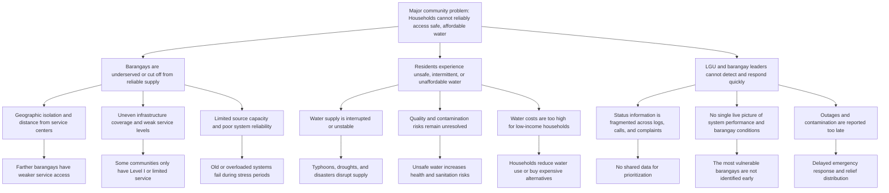

# WellPoint Problem Tree

## Major community problem
Households in geographically isolated and underserved barangays of Catbalogan City cannot reliably access safe, affordable water, even when a water source exists nearby. This is a water-security problem, not just a water-availability problem.

## Problem tree

## Three layers of direct root causes

### Layer 1: Immediate causes of water insecurity
- Inconsistent or interrupted water supply in remote barangays
- Low service coverage and weak distribution networks
- Water quality problems, contamination, and low pressure
- High cost of water access for low-income households

### Layer 2: Direct operational causes
- Water data is scattered across logs, radio reports, and resident complaints
- LGU staff do not have one live dashboard showing barangay-level status
- Outages and contamination are identified late instead of before they escalate
- There is no fast, trusted reporting and triage channel for communities

### Layer 3: Structural/root causes
- Geographic isolation makes service delivery harder and more expensive
- Uneven infrastructure investment leaves vulnerable barangays behind
- Climate and disaster events increase disruption to sources and systems
- Limited LGU capacity and fragmented coordination slow maintenance and emergency response

## Why this matters
These root causes create a cycle:
- households in vulnerable barangays receive less reliable service
- the LGU lacks timely information
- problems worsen before response happens
- communities face health, economic, and disaster risks

This is the gap WellPoint addresses by combining barangay geography, service reliability, affordability, and community reports into one early-warning and decision-support system.

## Short answer for submission
The major community problem is that many households in Catbalogan's remote and underserved barangays cannot reliably access safe, affordable water, even when water sources exist nearby. The direct root causes are weak infrastructure and service coverage, unreliable supply and quality issues, and poor monitoring and response coordination. Deeper structural causes include geographic isolation, uneven investment, disaster exposure, and limited LGU capacity to prioritize and act on the most vulnerable communities.
